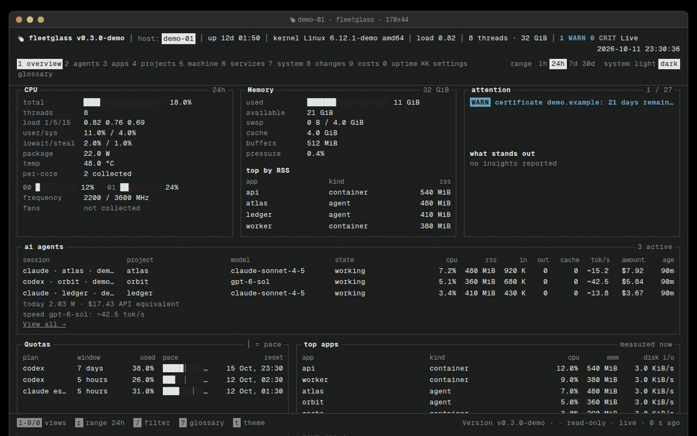
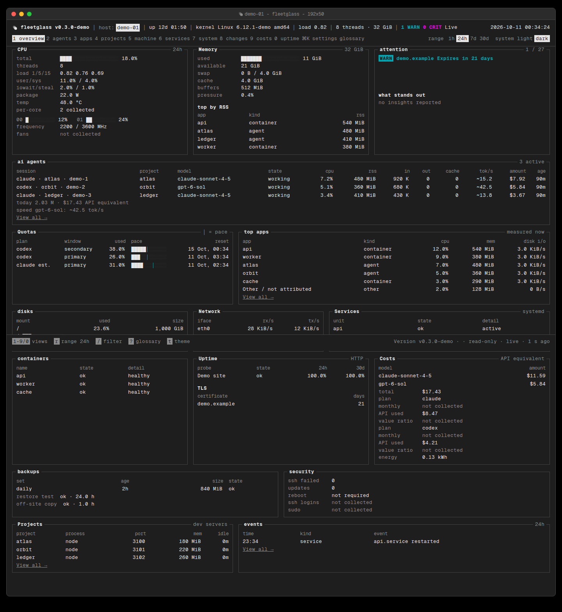
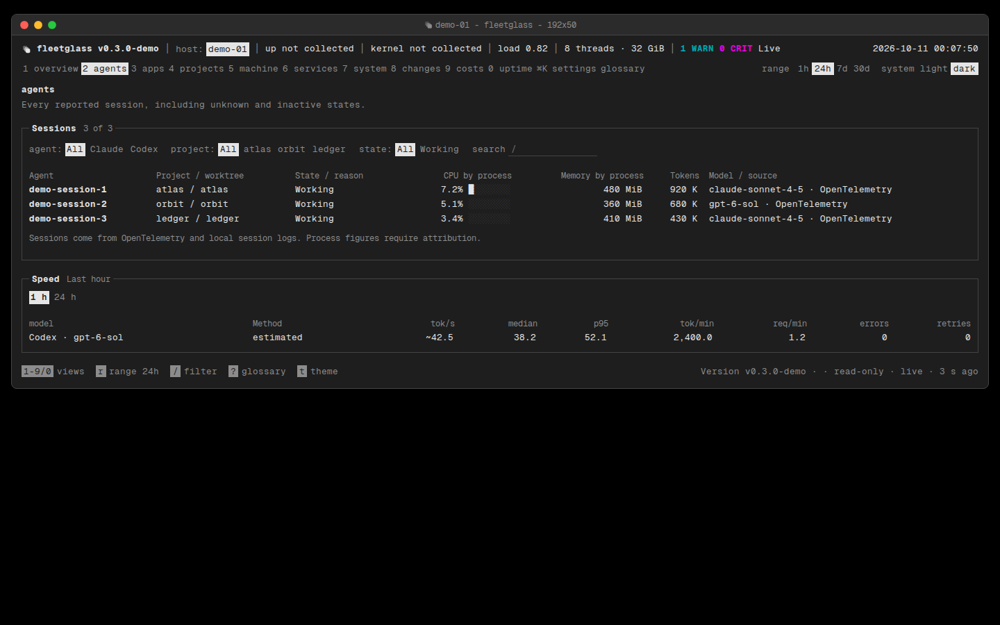
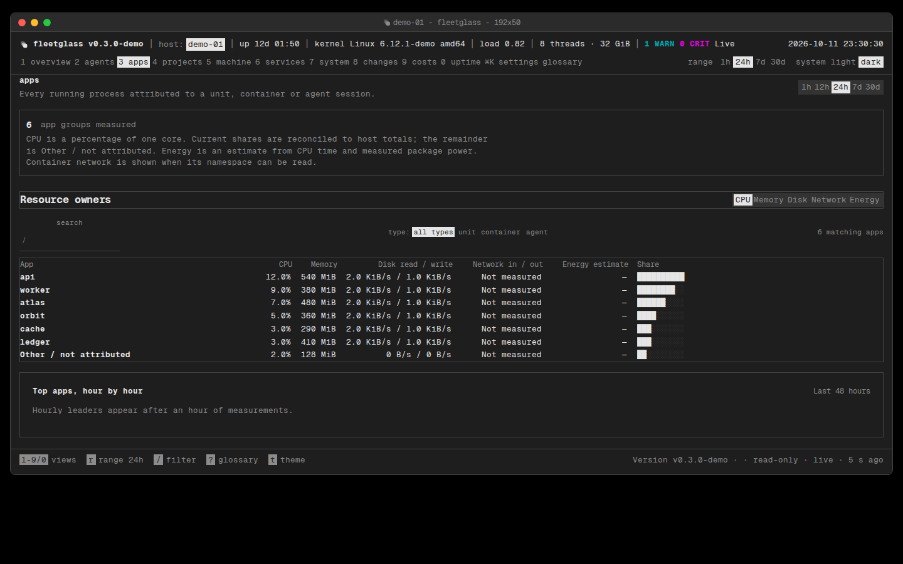
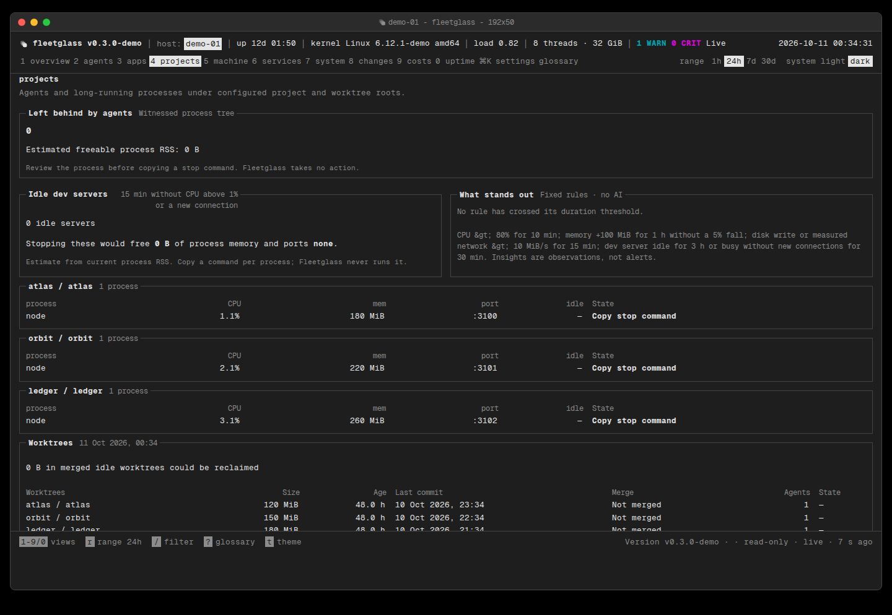

<div align="center">
  <picture><source media="(prefers-color-scheme: dark)" srcset="assets/brand/mark-mono-dark.svg"></picture>
  <h1>Fleetglass</h1>
  <p>One cockpit for your server and the AI agents running on it.</p>
  <p>
    <a href="https://github.com/thejoyfulist/fleetglass/actions/workflows/ci.yml"></a>
    <a href="https://github.com/thejoyfulist/fleetglass/releases"></a>
    <a href="LICENSE"></a>
    <a href="go.mod"></a>
    <a href="docs/INSTALL.md"></a>
  </p>
  <p><a href="#install">Install</a> · <a href="#features">Features</a> · <a href="#connect-your-agents">Connect agents</a> · <a href="#ask-it-from-your-agents-mcp">MCP</a> · <a href="#docs">Docs</a></p>
</div>



*Screenshots and demo use only the synthetic `demo-01`, `atlas`, `orbit`, and `ledger` fixture. [Watch the short demo](assets/screenshots/demo.mp4).*

## Why Fleetglass

- See which agent session and project is using CPU and memory, alongside token pace, model cost estimates, and subscription quotas, including optional Claude Code status-line limits.
- Spot active sessions with no observed file change for the configured interval; a cyan "loop?" flag suggests review.
- Know where every number comes from: each session metric is tagged OpenTelemetry, local logs, process or estimated.
- Check machine health, services, containers, projects, probes, and recent changes on one screen.
- Keep observations private: loopback listeners by default, local storage, and read-only host access.

## Install

Linux amd64/arm64 with systemd. Review [the installer](install.sh) before running it:

```sh
curl -fsSL https://raw.githubusercontent.com/thejoyfulist/fleetglass/main/install.sh | sudo sh
```

Preview the actions with `curl -fsSL https://raw.githubusercontent.com/thejoyfulist/fleetglass/main/install.sh | sudo sh -s -- --dry-run`. To pin a release, pass the version to `sudo`:

```sh
curl -fsSL https://raw.githubusercontent.com/thejoyfulist/fleetglass/main/install.sh | sudo FLEETGLASS_VERSION=v0.9.0 sh
```

See [install and upgrade](docs/INSTALL.md).

<details><summary>Manual verified install</summary>

Download the Linux archive and `SHA256SUMS` from the same [release](https://github.com/thejoyfulist/fleetglass/releases), then run:

```sh
sha256sum -c SHA256SUMS
tar -xzf fleetglass-vVERSION-linux-ARCH.tar.gz
cd fleetglass-vVERSION-linux-ARCH
sudo sh deploy/install.sh --dry-run
sudo sh deploy/install.sh
```

</details>

Open the cockpit at **http://127.0.0.1:7878** on the server. For private access from your laptop or phone, [Tailscale Serve](docs/EXPOSURE.md) can expose it only within your tailnet:

```sh
sudo tailscale serve --bg --https=8443 http://127.0.0.1:7878
```

Before exposing the cockpit through a proxy, add the hostname the browser uses to `allowed_hosts` in the server configuration, for example `"allowed_hosts": ["cockpit.example.test"]`. An entry without a port permits that hostname on any port; `"cockpit.example.test:8443"` restricts it to one port. The default accepts loopback names only. See [configuration](docs/CONFIGURATION.md).

## Connect your agents

Fleetglass receives OTLP/HTTP metrics and logs on `127.0.0.1:4318`. For Claude Code, add this `env` block to `~/.claude/settings.json` (merge it with existing settings):

```json
{
  "env": {
    "CLAUDE_CODE_ENABLE_TELEMETRY": "1",
    "OTEL_METRICS_EXPORTER": "otlp",
    "OTEL_LOGS_EXPORTER": "otlp",
    "OTEL_EXPORTER_OTLP_PROTOCOL": "http/protobuf",
    "OTEL_EXPORTER_OTLP_ENDPOINT": "http://127.0.0.1:4318"
  }
}
```

For Codex, add to `~/.codex/config.toml`:

```toml
[otel]
log_user_prompt = false
exporter = { "otlp-http" = { endpoint = "http://127.0.0.1:4318/v1/logs", protocol = "binary" } }
metrics_exporter = { "otlp-http" = { endpoint = "http://127.0.0.1:4318/v1/metrics", protocol = "binary" } }
```

See [agent setup](docs/AI-AGENTS.md) for attribution, local log fallback, and quota limits.

**FAQ: Can Fleetglass show Claude plan limits?** Yes. Add the optional `fleetglass-statusline` command to Claude Code's `statusLine` setting. Reported 5-hour and 7-day values take precedence over budget estimates when available. It reads only Claude Code's documented status-line input and does not access Claude OAuth credentials. See [Claude plan limits](docs/AI-AGENTS.md#claude-plan-limits).

## Features

| View | What it shows |
| --- | --- |
| Agents | Sessions, last observed file edit, possible-loop flag, token speed, cost by model and project, quotas with pace and runout forecast |
| Server | CPU, temperature, storage, energy, network |
| Services & uptime | systemd, containers, probes, TLS |
| Projects | Development servers, ports, worktrees, idle processes |
| Changes & security | Updates, journal errors, backups, recent changes |

<table>
  <tr><td><a href="assets/screenshots/overview-dark.png"></a></td><td><a href="assets/screenshots/agents-dark.png"></a></td></tr>
  <tr><td><a href="assets/screenshots/apps-dark.png"></a></td><td><a href="assets/screenshots/projects-dark.png"></a></td></tr>
</table>

Session metric sources: [light detail](assets/screenshots/agents-detail-light.png) · [dark detail](assets/screenshots/agents-detail-dark.png).

[See the possible-loop flag in a synthetic 1440×900 capture](assets/screenshots/loop-flag-dark.png).

[See the synthetic quota forecast at 1440×900](assets/screenshots/forecast-dark.png). Forecasts use recent quota history and show unknown when observations are insufficient; see [the method](docs/AI-AGENTS.md#quota-forecast).

Keyboard shortcuts: `1`–`9` views, `r` range, `/` search, `t` theme. The cockpit has light and dark themes and a mobile layout. [See the full screenshot set](assets/screenshots/).

## Ask it from your agents (MCP)

The read-only MCP endpoint is **off by default**. After [enabling its separate loopback listener and private token](docs/MCP.md), connect Claude Code with a private `.mcp.json`:

```json
{"mcpServers":{"fleetglass":{"type":"http","url":"http://127.0.0.1:7879/mcp","headers":{"Authorization":"Bearer ${FLEETGLASS_MCP_TOKEN}"}}}}
```

Or add to your private Codex `~/.codex/config.toml`:

```toml
[mcp_servers.fleetglass]
url = "http://127.0.0.1:7879/mcp"
bearer_token_env_var = "FLEETGLASS_MCP_TOKEN"
```

Load `FLEETGLASS_MCP_TOKEN` into the CLI's environment from its private token file. The four tools are `what_is_running`, `figure_attribution`, `what_is_on_port`, and `host_status`.

## Privacy & security

- No product telemetry is sent to the maintainers. The optional release check is off by default.
- Cockpit and OTLP bind to loopback by default; remote agent connections require HTTPS and a token.
- The local MCP endpoint, and OTLP when no token is configured, accept only loopback HTTP Host names to prevent DNS rebinding. SMART command output is capped at 1 MiB.
- Cockpit/API requests require an allowed HTTP Host and reject a different browser Origin.
- The agent runs without root; a small root helper has a fixed read allowlist.
- Prompts are filtered from ingestion and never stored. See the [security model](docs/SECURITY.md).

## How it compares

This is a comparison of **focus**, not a feature audit of other projects. “—” means no claim here.

| Focus | Agent sessions tied to processes | AI cost & quotas | Server health | Uptime probes | Self-hosted | MCP |
| --- | :---: | :---: | :---: | :---: | :---: | :---: |
| Fleetglass | ✓ | ✓ | ✓ | ✓ | ✓ | ✓ |
| General monitors (Netdata, Glances, btop/htop, Beszel) | — | — | ✓ | — | ✓ | — |
| Uptime Kuma | — | — | — | ✓ | ✓ | — |
| AI usage CLIs (ccusage-style) | — | Cost focus | — | — | — | — |

## Roadmap

Alert delivery and incident workflows (ntfy, Telegram, email), then broader agent support. [Product scope](docs/PRODUCT.md) distinguishes what ships today from planned work.

## FAQ

**Can it tell if an agent is stuck?** It can flag an active session with recent token output and no observed file change for 20 minutes by default. The interval starts when tool tracking begins for an already running session. Configured worktree scans can detect some shell edits through Git state changes; other shell edits and missing telemetry remain unknown. This is a hint, not proof of a loop. [Activity rule and supported tools](docs/AI-AGENTS.md#file-edit-activity).

**Does it send data?** No product telemetry is sent to the maintainers. Agents send measurements to the Fleetglass server you configure; optional update checks are off by default.

**Can it stop my agents?** No. Fleetglass only observes; it does not restart or kill processes.

**Does it work without Claude or Codex?** Yes. Machine, service, project, and uptime monitoring work independently.

**Can I tell measured from estimated?** Yes. Session provenance shows each metric’s feed, and `~` marks estimated speed and API-equivalent cost.

**Multiple servers?** Yes. Enroll remote agents with HTTPS and per-host tokens; see [multi-server setup](docs/MULTI-SERVER.md).

## Docs

[Install](docs/INSTALL.md) · [Configuration](docs/CONFIGURATION.md) · [Agent setup](docs/AI-AGENTS.md) · [MCP](docs/MCP.md) · [Security](docs/SECURITY.md) · [Operations](docs/OPERATIONS.md) · [Troubleshooting](docs/TROUBLESHOOTING.md) · [Changelog](docs/CHANGELOG.md)

## Contributing

Build and test instructions are in [CONTRIBUTING.md](CONTRIBUTING.md). Please use synthetic fixtures for screenshots and bug reports. [Report a vulnerability privately](SECURITY.md).

## License

Fleetglass is licensed under [AGPL-3.0](LICENSE).
