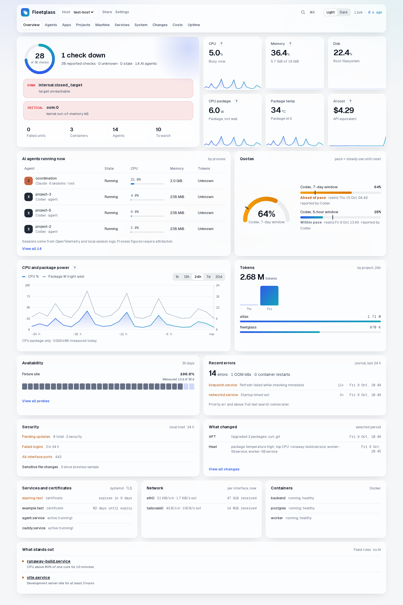
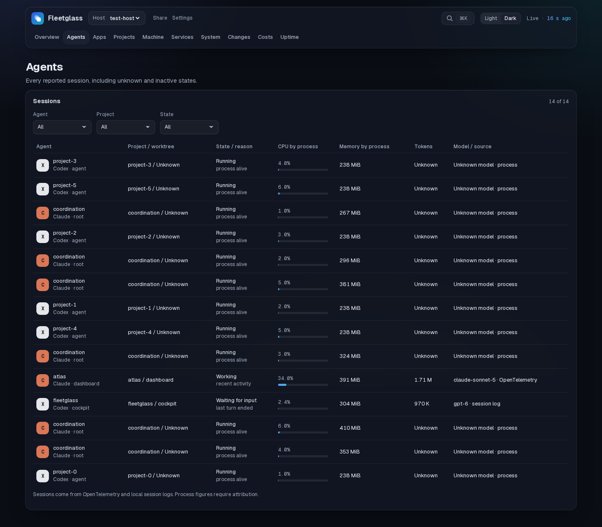

# Fleetglass

**See which AI agent is using your server, what it costs, and what changed around it.** Fleetglass is a self-hosted, read-only cockpit for Linux servers running Claude Code and Codex. It connects agent sessions and projects to processes, CPU, memory, quotas and incidents alongside full machine and service monitoring. Your data stays on your own server.



*Overview on a synthetic fixture host. All names and measurements in this image are test data.*

## One cockpit for the machine and its agents

- **AI sessions in context:** live Claude Code and Codex sessions, process trees, worktrees, token pace, quota forecasts, request speed and cost by project. OTLP is the primary feed; opt-in local logs are a fallback.
- **A name behind each number:** app groups by unit, container and agent session; CPU, memory, disk and measured container network; project dev servers, storage map and fixed-rule insights.
- **Server health:** CPU, memory, disks, SMART, RAPL energy, network, GPU when present, Docker, systemd, listening ports, TLS, updates, journal errors, backups and changes.
- **Availability across a fleet:** external and internal probes, 30-day history, a minimal public status page and per-host tokens for remote agents.
- **A private, installable cockpit:** live SSE updates, English and French, light and dark themes, phone layout, offline shell, read-only Prometheus export and an optional read-only MCP endpoint. No action can restart or change your host.



*Agent view generated from synthetic visual-check fixtures; no production data is included.*

## Quick start

Download a Linux amd64 or arm64 release bundle and its top-level `SHA256SUMS` from a release, then:

```sh
sha256sum -c SHA256SUMS
tar -xzf fleetglass-vVERSION-linux-ARCH.tar.gz
cd fleetglass-vVERSION-linux-ARCH
sudo sh deploy/install.sh --dry-run
sudo sh deploy/install.sh
```

Open `http://127.0.0.1:7878` on the machine, or use a private tunnel. The installer verifies the bundled binaries, creates a non-root account, detects local Docker sockets, SMART devices and relevant units, and starts the three systemd services. It never opens a network port. For upgrades, use `sudo sh deploy/install.sh --upgrade` from a new bundle. See [install and upgrade](docs/INSTALL.md) before deploying.

## Privacy and access

Fleetglass sends no telemetry. The optional release check is off by default. The agent never changes host state; the small root helper has a fixed read allowlist. The server keeps data in local SQLite, and you can create consistent online backups. OTLP input is filtered to measurements and approved metadata, excluding prompts, credentials, command lines, MAC addresses and serial numbers. The cockpit binds to loopback by default, while remote agents require HTTPS and their own token.

## Documentation

- [Install and upgrade](docs/INSTALL.md) · [Configuration](docs/CONFIGURATION.md) · [Troubleshooting](docs/TROUBLESHOOTING.md)
- [Security and privacy](docs/SECURITY.md) · [Database backup and restore](docs/BACKUP.md) · [Safe cockpit exposure](docs/EXPOSURE.md)
- [AI agent setup](docs/AI-AGENTS.md) · [Multi-server setup](docs/MULTI-SERVER.md) · [MCP setup](docs/MCP.md) · [Prometheus and operations](docs/M9D-OPERATIONS.md)
- [Product scope](docs/PRODUCT.md) · [Changelog](docs/CHANGELOG.md)

## Build from source

Go 1.26 and Node 24 are used. The committed `web/dist` is embedded in the server, so a normal Go build needs no Node runtime. For UI changes, run `npm ci`, `npm test` and `npm run build` in `web/`, then commit the updated `dist`. Run `go test ./...` and `go vet ./...` at the repository root. `./scripts/release.sh /path/to/output` produces deterministic Linux amd64 and arm64 tarballs with SHA-256 checksums. It derives release versions from `vMAJOR.MINOR.PATCH` git tags; untagged builds are marked as development builds.

Fleetglass is licensed under [AGPL-3.0](LICENSE).
